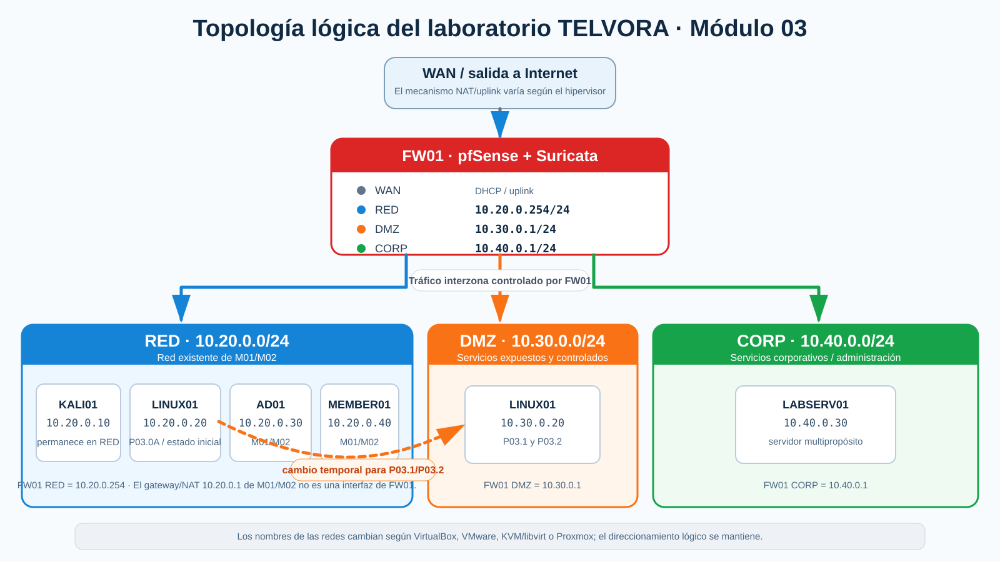

# M03 — Arquitecturas de Ciberseguridad
## Laboratorios del módulo

**Programa:** Programa Avanzado de Ciberinteligencia y Ciberdefensa  
**Empresa ficticia:** Telvora Communications (TELVORA)  
**Entorno:** Telvora Cyber Range  
**Dominio de laboratorio:** `telvora.lab`

En este módulo el objetivo es pasar del análisis de riesgo a la **implementación y validación de una arquitectura defensiva**.

## P03.0 — Prácticas adicionales de arquitectura

### P03.0A — Telvora Host Microsegmentation & Evidence Lab

- [Enunciado](P03.0A_Telvora_Host_Microsegmentation/ENUNCIADO.md)
- [Script de validación de flujos](P03.0A_Telvora_Host_Microsegmentation/validate_flows.sh)
- [Matriz de validación](P03.0A_Telvora_Host_Microsegmentation/MATRIZ_VALIDACION.csv)

Conceptos: microsegmentación en host, `default deny`, protección del management plane, logging y validación positiva/negativa.

### P03.0B — Telvora Architecture as Code & Guardrails Lab

- [Enunciado](P03.0B_Telvora_Architecture_as_Code/ENUNCIADO.md)
- [Terraform inicial](P03.0B_Telvora_Architecture_as_Code/main.tf)
- [Guardrails de arquitectura](P03.0B_Telvora_Architecture_as_Code/TELVORA_GUARDRAILS.md)
- [Checker policy-as-code](P03.0B_Telvora_Architecture_as_Code/iac_guardrails.py)

Conceptos: responsabilidad compartida, IaC, policy-as-code, guardrails, DevSecOps, validación y riesgo residual.

## Laboratorios principales

### P03.1 — Telvora Segmentation Lab

- [Enunciado](P03.1_Telvora_Segmentation_Lab/ENUNCIADO.md)
- [Matriz de validación T01–T06](P03.1_Telvora_Segmentation_Lab/MATRIZ_VALIDACION.csv)

### P03.2 — Telvora Network Detection Lab

- [Enunciado](P03.2_Telvora_Network_Detection_Lab/ENUNCIADO.md)
- [Regla Suricata de partida](P03.2_Telvora_Network_Detection_Lab/telvora_m03.rules)

### P03.3 — Telvora Cloud Architecture Review

- [Enunciado](P03.3_Telvora_Cloud_Architecture_Review/ENUNCIADO.md)
- [Terraform inicial bajo revisión](P03.3_Telvora_Cloud_Architecture_Review/main.tf)

## Relación con los bloques del módulo

| Laboratorio | Conceptos principales |
|---|---|
| P03.0A | microsegmentación · management plane · default deny · telemetría · validación positiva/negativa |
| P03.0B | responsabilidad compartida · IaC · policy-as-code · guardrails · DevSecOps · riesgo residual |
| P03.1 | segmentación por intención · firewall stateful · mínimo privilegio · evidencia de flujos |
| P03.2 | IDS/IPS · ubicación de sensores · alertas · correlación · tuning |
| P03.3 | responsabilidad compartida · IaC · CSPM · policy-as-code · DevSecOps |

## Entorno de laboratorio



La topología lógica es la misma con independencia del hipervisor. Los nombres de las redes virtuales cambian, pero el direccionamiento y las zonas de seguridad se mantienen.

### Plan de direccionamiento

| Zona | Red | Interfaz de FW01 | Hosts relevantes |
|---|---|---|---|
| RED | `10.20.0.0/24` | `10.20.0.254` | KALI01 `.10`, LINUX01 `.20` inicialmente, AD01 `.30`, MEMBER01 `.40` |
| DMZ | `10.30.0.0/24` | `10.30.0.1` | LINUX01 `.20` durante P03.1 y P03.2 |
| CORP | `10.40.0.0/24` | `10.40.0.1` | LABSERV01 `.30` |

> **Importante:** `10.20.0.1` sigue siendo el gateway/NAT de la red de laboratorio creada en M01/M02 cuando el hipervisor lo utiliza. **No es una interfaz de FW01.** La interfaz RED de FW01 es `10.20.0.254`.

### Equivalencia de redes por hipervisor

| Zona | VirtualBox | VMware Workstation | KVM/libvirt | Proxmox |
|---|---|---|---|---|
| RED | `TELVORA-M01` | `VMnet1` | `telvora-lab` | `vmbr20` |
| DMZ | `TELVORA-DMZ` | `VMnet2` | `telvora-dmz` | `vmbr30` |
| CORP | `TELVORA-CORP` | `VMnet3` | `telvora-corp` | `vmbr40` |

La salida a Internet/WAN puede variar según el hipervisor y queda fuera de las pruebas de segmentación. El **tráfico entre RED, DMZ y CORP** debe atravesar FW01.

### Transición de LINUX01

En P03.0A, LINUX01 permanece en la red original:

```text
KALI01   10.20.0.10  RED
LINUX01  10.20.0.20  RED
```

Antes de P03.1, y siguiendo las indicaciones del instructor, LINUX01 pasa temporalmente a DMZ:

```text
LINUX01  10.30.0.20/24
Gateway  10.30.0.1
```

KALI01 permanece en RED y utiliza FW01 (`10.20.0.254`) como siguiente salto para alcanzar DMZ y CORP.

### Acceso de administración a FW01

Desde KALI01:

```text
https://10.20.0.254
```

El acceso se realiza desde RED; no es necesario conectar el host físico a CORP.

### P03.0A

Utiliza:

```text
KALI01
LINUX01
```

### P03.0B

Utiliza:

```text
KALI01
```

Requiere Python 3, los archivos del repositorio y un editor de texto. No se despliega infraestructura cloud.

### P03.1

Utiliza:

```text
FW01
KALI01
LINUX01
LABSERV01 en la fase CORP/DMZ
```

Para equipos con memoria limitada, LABSERV01 puede arrancarse después de apagar KALI01.

### P03.2

Utiliza la topología segmentada ya preparada en P03.1:

```text
FW01
LINUX01   10.30.0.20  DMZ
LABSERV01 10.40.0.30  CORP
```

Suricata está **preinstalado** en FW01, pero su configuración forma parte de la práctica.

### P03.3

Utiliza:

```text
LABSERV01
```

La revisión se realiza sobre IaC mediante Checkov u otra herramienta indicada por el instructor. No se despliegan recursos cloud.

## Entregables del M03

### P03.0A

- política de comunicaciones;
- reglas de microsegmentación;
- matriz antes/después;
- prueba positiva;
- prueba negativa;
- evidencia de logging;
- Architecture Validation Brief.

### P03.0B

- revisión manual inicial;
- resultado inicial de guardrails;
- `main.tf` corregido;
- resultado final;
- análisis de policy-as-code y pipeline;
- Architecture Review Brief.

### P03.1

- tabla de aliases;
- reglas aplicadas;
- matriz de validación T01–T06;
- evidencias de firewall;
- respuestas de arquitectura.

### P03.2

- configuración básica Suricata;
- regla local 1000001;
- segunda regla propia;
- evidencias de alertas;
- correlación firewall/IDS;
- Detection Brief.

### P03.3

- `main.tf` inicial;
- resultado Checkov inicial;
- `main.tf` corregido;
- resultado Checkov final;
- matriz multicloud;
- Architecture Review.

## Principios del módulo

- Una arquitectura no está validada hasta probar sus flujos.
- `Allow` y `alert` no son conceptos contradictorios.
- Segmentación reduce alcance; no elimina vulnerabilidades.
- Una DMZ no convierte un servidor en seguro.
- Zero Trust no significa “poner más firewalls”.
- El proveedor cloud no configura por ti todos los controles del cliente.
- IaC permite revisar seguridad antes del despliegue.
- Compliance no equivale a seguridad.
- Un check automático es evidencia, no una decisión.
